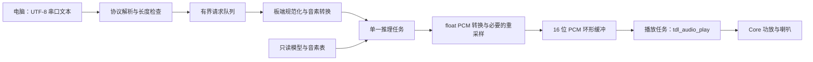

# T5AI-Core 本地 sanoTTS 方案

日期：2026-10-27。状态：供其他 agent 执行的设计基线，尚未完成板端验证。

2026-10-29 Review 修订：增加资源预检查、分段/取消接口和计时口径；M3 是必达功能目标，M4 是独立性能目标。若物理资源不可满足，应交付不可行证据和调整选项，不将阶段成果描述为整体完成。

## 1. 目标与边界

实施仓库固定为 `/home/share/samba/tyopen/TuyaOpen`。2026-10-29 已执行 `git fetch origin master`，本地 master 与 origin/master 均为 `695e571fb4f62932dbf86a86fde664fcb7f2c0b4`。正式启动时再次 fetch，并从当时最新 `origin/master` 创建项目分支，记录实际基线。不得从原 ePanda 工作区的功能分支移植整套历史改动。

最终目标：电脑串口发送 UTF-8 中文文本，T5AI-Core 本地完成文字转音素、神经语音合成和喇叭播放。运行期间不依赖电脑生成音素，不调用云端 TTS。

输入问题只会朗读问题；生成回答属于另一个系统，本方案不包含 LLM、语音识别、配网、设备授权、云产品和 DP。

允许第一阶段先合成后播放；实时合成作为独立性能等级验收。不能用预录音频、电脑生成 PCM 或电脑生成音素冒充最终成果。

## 2. 事实与尚需验证的项目

- 板型固定为 `TUYA_T5AI_CORE`，不是 `TUYA_T5AI_BOARD`。
- 官方规格：最高 480 MHz M33F、8 MB Flash、16 MB PSRAM、640 KB 共享 SRAM。实际运行频率、应用可用 SRAM、PSRAM 最大连续块均需测量。
- 本地 `boards/T5AI/TUYA_T5AI_CORE/tuya_t5ai_core.c` 已注册音频，默认 16 kHz、16 位、单声道，功放使能 GPIO39。
- 串口可参考 `examples/peripherals/uart/src/example_uart.c`，播放可参考 `examples/peripherals/audio_codecs/output_speaker/src/example_output_speaker.c`。
- 调研固定上游提交为 `f73b8382bc98a1c8de3488ba30d727ab82587828`。实施时先验证对象可下载，资源清单记录最终选用的提交和 SHA-256；切换提交须重跑数值基线。
- 先选有硬件测试的 `en_us_e12nano` 英文 INT8 谱系，约 294,642 参数。不要把它与 `heart-nano` 的资源、采样率、golden fixture 混用。
- 中文初始基线固定为 `web/voices/chinese`，前端为 eSpeak `cmn`，输出 22,050 Hz。其前端和解码器权重文件合计 5,999,036 字节，配置中的权重数合计 1,499,481。
- 中文初始基线不是 `chinese-xiaoya`。后者使用拼音前端，切换意味着模型、音素表和前端一起更换，不是替换一个字典。
- 对中文 FP32 解码器按源码公式估算，临时工作区约 6,350,400 字节/秒输出音频，3 秒约 19.1 MB；不含权重、PCM 和系统。因此完整句子原样推理不作为落地方案。
- 上游 MCU 核心接收音素 ID，不直接接收文字。RTF、相关系数和音量比均需在具体模型、编译参数及硬件上复测。

以上资源数字是上游资料或源码推导，不是 T5 的测试成绩。

## 3. 路线选择

| 路线 | 价值 | 决策 |
|---|---|---|
| 英文 nano → 中文短块基线 → 板端中文前端 | 每一步可定位瓶颈，尽早获得实机数据 | 主路线 |
| 直接完整移植中文浏览器路径 | 最快暴露中文问题，但整句工作区超过内存 | 只用于主机参考，不直接搬上板 |
| 直接训练中文 nano/蒸馏/量化 | 可能更适合产品，涉及训练资源和音质回归 | 当前中文路线不达标后再决策，不算常规移植任务 |

先用主路线，保留“中文受限离线播报”和“实时中文播报”两个独立结论。前者成功不代表后者成功。

## 4. 架构

模型回调只做有界转换和缓冲写入，不在 ISR 合成，不从多个任务同时调用上游全局状态或 eSpeak。推理回调可等待缓冲空间，但等待必须有超时，且必须能响应取消。

PCM 缓冲是独立的 I/O 缓冲，不代表模型内部已经流式化。中文整句工作区必须通过解码分块减少，不能靠增大 PCM 环形缓冲解决。

首次中文采用：整句预测时长/声学特征，解码器按 latent frame 分块，带所需左右上下文，仅保留块中心输出。完整前端的内存也必须预算；不够时限制单段长度并分句。依据卷积、反卷积和后滤波器推导上下文，禁止任意截断卷积历史。

文字前端按顺序回调输出有界音素段，集成任务逐段合成和播放，不要求整篇文本装入一个 256 音素数组。STOP 的接收确认与实际停止分开记录；推理、G2P、缓冲等待都要有取消检查点，确认收到 STOP 不代表模型已停止。

## 5. 验收分层

| 层级 | 必须证明 | 不代表什么 |
|---|---|---|
| M0 硬件链路 | 串口收发、16 kHz 测试音、无错误重启 | 尚无 TTS |
| M1 板端英文模型 | 固定音素在 T5 合成；数值门禁通过并播放 | 尚无文字前端 |
| M2 中文合成验证 | 电脑提供匹配中文音素，T5 分块合成；输出与主机参考一致 | 尚未完全离线端到端 |
| M3 完整中文流程 | 串口原始中文进入，板端完成前端与合成，断网可播报 | 不自动意味着实时 |
| M4 实时等级 | M3 基础上达到性能指标和连续播放要求 | 未达标须如实保留受限版本结论 |

M3 支持范围：普通简体中文、常用标点、明确规则覆盖的整数/小数/日期/时间；中英混读、儿化、生僻字和未覆盖多音字记录实际表现，不默认为支持。未知字符必须可定位地报告，禁止静默删除后宣称全文播报正确。

## 6. 资源和性能门禁

- 英文初始 arena 预算 160 KiB；若 golden 长度不适用，以实际 sizing 和最大连续块调整，禁止把全部 SRAM 当作可用堆。初版允许 PSRAM arena；SRAM 放置由测量决定。
- 用户已授权将整块 8 MB Flash 与 16 MB PSRAM 用于本项目。执行者可自主重划 Flash 分区、SRAM/PSRAM 区域和堆布局，取消 OTA、授权/业务数据和不需要的音视频/显示预留区；这些调整无需再次确认。只保留项目启动和硬件运行确实必需的内容，记录布局、必要原始数据备份及恢复方法。8 MB 总容量仍需包含固件和必需系统开销。
- 正式开展中文板端集成前，先核算启动固件、模型、中文字典、文件系统开销和需保留分区，按项目专用布局确认能装入实际 8 MB Flash，不要求兼容原 OTA 或业务布局；同时核算带真实上下文的分块峰值与实测可用连续 PSRAM。两个门禁未通过时，不默认增加外部存储或开展训练。
- PCM 环形缓冲初始 32 KiB，放 PSRAM；16 kHz 单声道 16 位约容纳 1.024 秒。DMA/驱动有内部内存限制时，增加小型内部 staging buffer。
- 中文解码初始中心块长 16 latent frames，约 186 ms；实际工作区按“中心块 + 左右上下文”计算。将块长 8/16/32 做对照，选择通过数值和内存门禁的配置。
- 默认 16 kHz 播放。若驱动确认支持模型原生采样率，可使用原生输出；否则用有抗混叠滤波的有理数重采样。不能直接把 22.05/24 kHz PCM 按 16 kHz 播放。
- 每个模型单独测量 compute-only RTF 和端到端 wall time；后者包含队列、G2P、等待播放和设备排空，不得混为合成性能。
- 数值门禁在模型原生采样率、重采样之前执行；重采样和喇叭实际输出另外验收。`first_pcm` 从收到完整有效请求开始，到首个可播放输出帧就绪；有声输出延迟须结合驱动排队/回采另行测量，不能以模型首次回调替代。
- 提议的 M4 目标：固定测试集 compute-only RTF 的 p95 ≤ 0.8，首个实际可播放 PCM 延迟的 p95 ≤ 1.5 秒；预缓冲后不出现可听欠载。该目标是验收要求，不是预测成绩。
- M4 还要求包含规范化、G2P、分块重叠计算、重采样与调度成本的持续生产速率能跟上播放；不能仅凭 compute-only RTF 判定实时。
- M3 允许 RTF > 1：先生成有界段，再播放；如需边算边播且长期 RTF > 1，必须报告不可持续，不能用短句预缓冲掩盖。

## 7. 上游参考

以下源码链接均固定调研提交：

- [硬件测试与 golden 门禁](https://github.com/Ampixa/sanoTTS/blob/f73b8382bc98a1c8de3488ba30d727ab82587828/BOARDS.md)
- [nano API](https://github.com/Ampixa/sanoTTS/blob/f73b8382bc98a1c8de3488ba30d727ab82587828/mcu/include/snt_nano.h)
- [移植接口](https://github.com/Ampixa/sanoTTS/blob/f73b8382bc98a1c8de3488ba30d727ab82587828/mcu/include/snt_port.h)
- [中文模型配置](https://github.com/Ampixa/sanoTTS/blob/f73b8382bc98a1c8de3488ba30d727ab82587828/web/voices/chinese/meta.json)
- [FP32 解码及 arena 公式](https://github.com/Ampixa/sanoTTS/blob/f73b8382bc98a1c8de3488ba30d727ab82587828/mcu/src/snt_piperlite.c)
- [ESP32 eSpeak 移植参考](https://github.com/Ampixa/sanoTTS/blob/f73b8382bc98a1c8de3488ba30d727ab82587828/mcu/ports/esp32s3/firmware/components/espeak-ng/README.md)
- [授权的文件范围](https://github.com/Ampixa/sanoTTS/blob/f73b8382bc98a1c8de3488ba30d727ab82587828/LICENSE.MIT)
- [T5AI-Core 官方资料](https://docs.tuyaopen.ai/zh/docs/hardware/tuya-t5/t5-ai-core/overview-t5-ai-core)

执行计划见 [t5_core_sanotts_plan.md](t5_core_sanotts_plan.md)。
